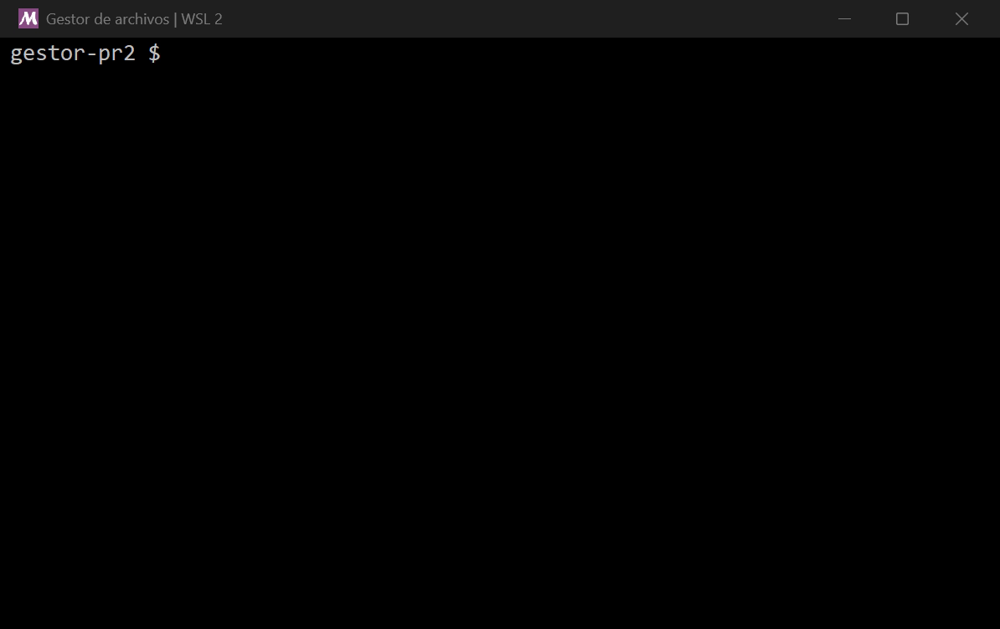

# Gestor de archivos distribuido

El cliente A sube `plano.txt`. Mientras A sigue conectado, B encuentra el archivo a través de otra réplica. La última línea confirma que los 33 bytes guardados en el volumen tienen el mismo SHA-256 que el original.

La vista previa acorta la espera entre clientes. Pulsa la imagen para descargar la grabación completa de la ventana (23,8 s).

Chengxun Wu preparó los [Dockerfiles](despliegue/imagenes) y los [manifiestos de Kubernetes](despliegue/k8s) para desplegar un broker y dos réplicas con almacenamiento NFS. La demo se ejecutó en WSL 2 con un directorio local compartido. En una prueba separada de descarga, la copia de cinco bytes tenía un SHA-256 distinto del original.

Reproducir con los tres ejecutables de la asignatura

1. Usa Linux x86-64 o Ubuntu en WSL 2, con Python 3, `unshare`, `ip` y `ss`. El sistema debe permitir crear espacios de nombres de usuario y de red.
2. Copia `brokerFileManager`, `serverFileManager` y `clientFileManager` del material de la asignatura a una carpeta `bin/` en la raíz del proyecto.
3. Ejecuta `sh demo.sh` en Linux o abre `Probar.cmd` en Windows con Ubuntu en WSL 2. Pulsa Intro en cada paso. El broker tarda unos 11 segundos en recibir la actualización de carga de las réplicas.

Usar la configuración de Kubernetes

Sustituye `nfs.example.invalid` por tu servidor NFS y ajusta la ruta exportada y las etiquetas de imagen. Para reconstruir las imágenes, coloca el ejecutable correspondiente junto a cada Dockerfile y crea `FileManagerDir/` junto al Dockerfile del servidor.

